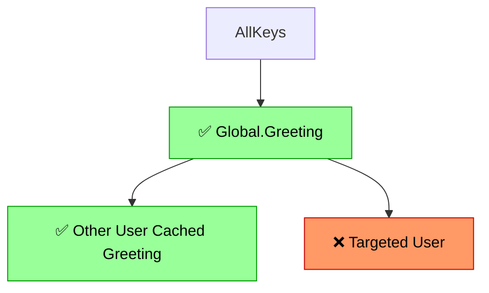
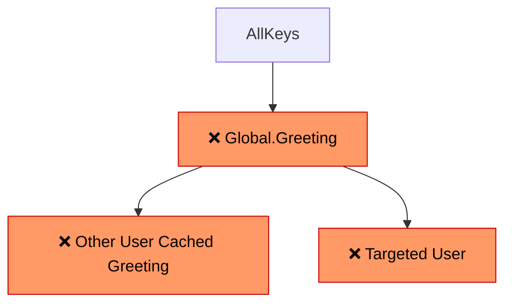

# fragmented-keys

Tag-versioned cache invalidation for TypeScript.

## Overview

Fragmented Keys provide a straightforward way to manage and invalidate composite cache keys.

The library persists tag-instance versioning information in Redis (or an in-memory backend for testing). When constructing composite/fragmented keys, these tags and their current versions are combined to generate the final cache key. Instead of deleting stale cache entries, you increment a tag's version — all composite keys depending on that tag resolve to a new hash, producing automatic cache misses. Old entries expire naturally via TTL.

### How Invalidation Works

Say you have cached data tied to both a global greeting template and a per-user username. You can selectively invalidate only items linked to a specific user:

```typescript
const userTag = ring.tag("User.Username", userId);
await userTag.increment();
```

Behind the scenes, only the targeted user's cached data is invalidated — everything else remains valid:



Or you could invalidate *all* keys that depend on `Global.Greeting` — but make sure your database is ready for the traffic spike:

```typescript
const greetingTag = ring.tag("Global.Greeting", "global");
await greetingTag.increment();
```



This tree-structured invalidation is the core power of fragmented keys: fine-grained control over which cached data expires, without needing to track individual cache entries.

Tags represent a logical grouping that you would, under certain circumstances, want to invalidate associated cached data for. A `User:{id}` pair, a `Site:{siteId}`, etc. The library appends `@version` fields to tag-instance pairs so that when you want to invalidate a large swath of related items, you don't need to send dozens of delete requests to your cache — you make a single `tag.increment()` call and any keys using that tag-instance produce new cache keys automatically.

## Install

```bash
npm install fragmented-keys
```

### Optional peer dependencies

```bash
npm install ioredis    # for Redis support
npm install rxjs       # for Observable adapter (planned)
```

## Quick Start

```typescript
import { Configuration } from "fragmented-keys/configuration";
import { MemoryHandler } from "fragmented-keys/cache-handler/memory-handler";
import { FragmentedKeyRing } from "fragmented-keys/key-ring/fragmented-key-ring";

// 1. Configure a cache handler
const handler = new MemoryHandler();
Configuration.setDefaultCacheHandler(handler);

// 2. Create a key ring and define keys
const ring = new FragmentedKeyRing("my-app");
ring.defineKey("user-profile", ["user", "settings"]);

// 3. Get a key object — tags are resolved, hash is computed
const key = ring.getKeyObj("user-profile", ["42", "default"]);
const cacheKey = await key.getKeyStr();

// 4. Invalidate by incrementing a tag
const userTag = ring.tag("user", "42");
await userTag.increment();
// All keys depending on user:42 now resolve to a different hash
```

## Configuration

The library uses a static `Configuration` singleton:

```typescript
import { Configuration } from "fragmented-keys/configuration";

// Required: set the default cache handler
Configuration.setDefaultCacheHandler(handler);

// Optional: global prefix for all tag keys (default: "DefaultPrefix")
Configuration.setGlobalPrefix("MyApp");

// Optional: cache prefix prepended to all handler reads/writes
// Useful for multi-tenant or multi-environment Redis sharing
Configuration.setCachePrefix("staging:");
```

## Redis Setup

### Single Instance

```typescript
import Redis from "ioredis";
import { Configuration } from "fragmented-keys/configuration";
import { RedisHandler } from "fragmented-keys/cache-handler/redis-handler";

const redis = new Redis({ host: "localhost", port: 6379 });
const handler = new RedisHandler(redis);
Configuration.setDefaultCacheHandler(handler);
```

### Custom Group Name

Pass a second argument to identify the handler in multi-handler setups:

```typescript
const handler = new RedisHandler(redis, "primary-redis");
handler.groupName(); // "primary-redis"
```

### With TTL

```typescript
// Tag versions stored with 1-hour TTL
await handler.set("tag:user:42", "1.1", 3600);
```

### Docker (Development)

The included `docker-compose.yml` provides Redis standalone and a 3-node Sentinel cluster:

```bash
# Start all Redis services
docker compose up -d

# Standalone Redis on localhost:6379
# Sentinel master on localhost:6380
# Sentinels on localhost:26379, 26380, 26381
```

```typescript
// Connect to standalone
const redis = new Redis({ host: "localhost", port: 6379 });

// Connect via Sentinel (when RedisSentinelHandler is available)
const redis = new Redis({
  sentinels: [
    { host: "localhost", port: 26379 },
    { host: "localhost", port: 26380 },
    { host: "localhost", port: 26381 },
  ],
  name: "mymaster",
});
```

## Cache Handlers

| Handler | Backend | Status |
|---------|---------|--------|
| `MemoryHandler` | In-memory Map | Available |
| `RedisHandler` | ioredis single instance | Available |
| `RedisSentinelHandler` | ioredis + Sentinel HA | Planned |
| `RedisShardRouter` | Multi-shard routing | Planned |
| `EncryptedHandler` | Encrypt/decrypt decorator | Planned |

All handlers implement the `CacheHandler` interface:

```typescript
interface CacheHandler {
  groupName(): string;
  get(key: string): Promise<string | null>;
  set(key: string, value: string, ttl?: number): Promise<void>;
  getMulti(keys: string[]): Promise<Record<string, string>>;
}
```

## How It Works

1. Each `StandardTag` stores its current version in the cache backend under a key derived from the tag name, instance, and global prefix.
2. When building a composite key, `StandardKey` bulk-fetches all tag versions using `getMulti` (grouped by handler) for efficiency. `ConstantTag` instances are skipped in bulk fetches since their version is fixed.
3. The final key is `md5("{keyName}_{groupId}:t{tag1Name}:v{version1}:t{tag2Name}:v{version2}...")`.
4. Calling `tag.increment()` bumps the stored version by `0.1`, so subsequent key builds produce a different MD5 — effectively invalidating all cached data under the old key without deleting it.

## Development

```bash
npm install
npm run build        # Build with tsup (ESM + CJS)
npm test             # Run unit tests
npm run test:integration  # Run integration tests (requires Docker Redis)
npm run lint         # Check with Biome
npm run typecheck    # TypeScript type checking
```

## Cross-Language Parity

This is the TypeScript implementation of the fragmented-keys pattern. Implementations also exist for PHP, Python, Java, Swift, and Elixir. Core tag/key/ring semantics are identical across all versions.

## License

MIT — Noizu Labs, Inc.
