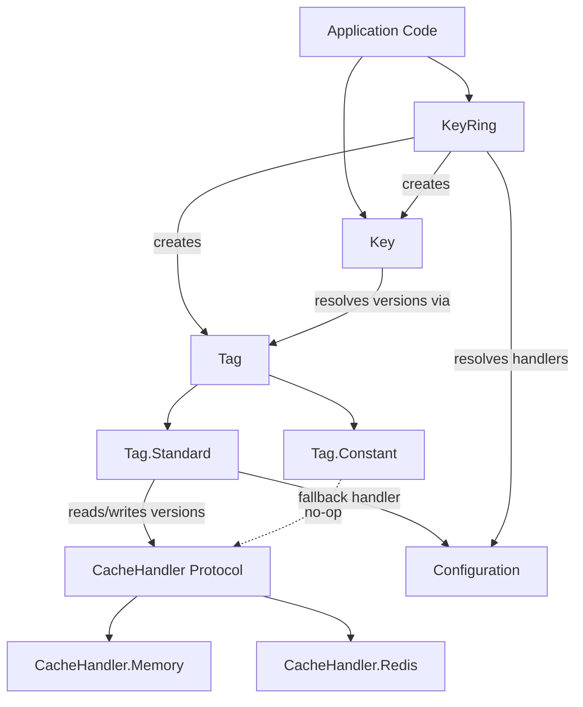

# Project Architecture

## Overview

FragmentedKeys is an Elixir library for composite cache key management. Instead of bulk-deleting cached entries when data changes, it composes cache keys from multiple independently versioned **tags**. Incrementing a tag's version causes all dependent keys to resolve to new hashes — stale entries simply expire naturally.

The library is designed as a dependency (not a standalone application) with no supervision tree required. Global state uses `:persistent_term` for near-zero-cost reads.

## System Diagram

## Core Components

| Component | Purpose |
|-----------|---------|
| `Key` | Composes a cache key string (MD5) from base name + ordered tag versions |
| `Tag` | Unified dispatch for tag operations (version fetch, increment, reset) |
| `Tag.Standard` | Versioned tag — version stored in cache, incrementable |
| `Tag.Constant` | Fixed-version tag — mutation operations are no-ops |
| `KeyRing` | Factory for defining key templates and instantiating keys from definitions |
| `CacheHandler` | Protocol defining cache backend interface (get/set/get_multi) |
| `CacheHandler.Memory` | Agent-backed in-memory implementation for testing/dev |
| `CacheHandler.Redis` | Redix-backed implementation (optional dependency) |
| `Configuration` | Global defaults via `:persistent_term` (handler, prefix) |

## Key Invalidation Strategy

Tags represent versioned dimensions of cached data (e.g., "User:42", "City:chicago"). A composite key hashes the base name with all tag versions. When a tag is incremented, the hash changes — new lookups miss the old entry and populate fresh data. No cache deletes required.

→ *See [invalidation.md](invalidation.md) for details*

## Cache Handler Protocol

The `CacheHandler` protocol abstracts storage backends behind four functions: `group_name/1`, `get/2`, `set/4`, `get_multi/2`. Tags sharing a handler group have their versions bulk-fetched in a single `get_multi` call for efficiency.

→ *See [cache-handler.md](cache-handler.md) for details*

## Technology Stack

| Layer | Choice |
|-------|--------|
| Language | Elixir 1.19+ / OTP 28 |
| Global state | `:persistent_term` (no GenServer/ETS needed) |
| Memory backend | `Agent` |
| Redis backend | `Redix` (optional dep) |
| Hashing | `:crypto.hash(:md5, ...)` |

## Key Decisions

- **Protocol over behaviour**: `CacheHandler` is a protocol so dispatch is struct-based — no atom registry or config lookup needed
- **No supervision tree**: Uses `:persistent_term` for config and `Agent` for memory cache — the library stays out of the host app's supervision
- **Bulk version fetching**: Tags are grouped by handler and fetched with `get_multi` to minimize round-trips
- **MD5 for key hashing**: Fast, fixed-length output suitable for cache keys (not security-sensitive)
