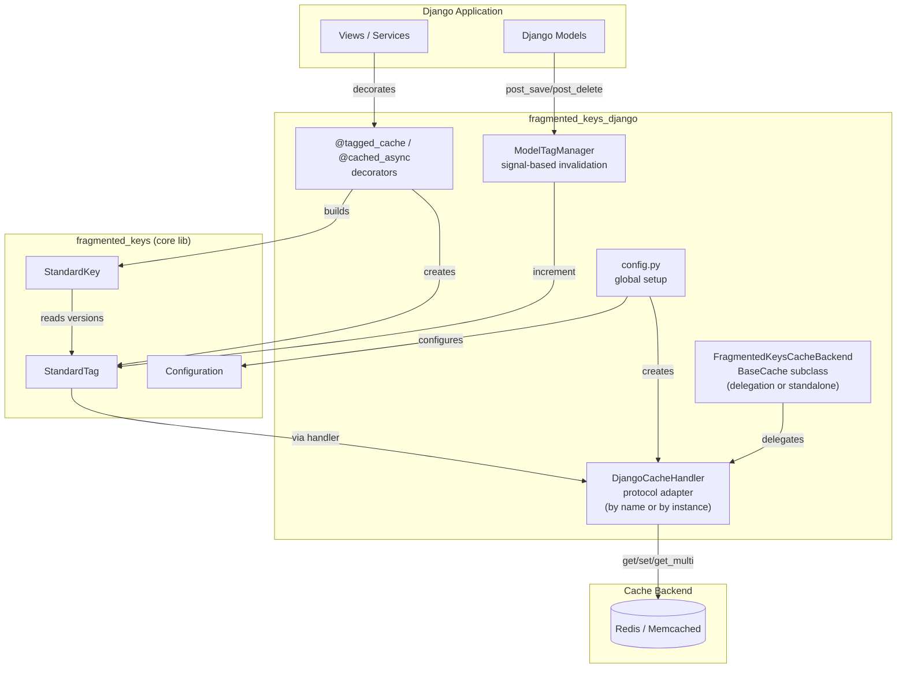

# Project Architecture

## Overview

`fragmented-keys-django` is a Django integration layer for the [`fragmented-keys`](https://pypi.org/project/fragmented-keys/) library. It provides tag-versioned cache invalidation: cache keys are composed from tag versions, so incrementing a tag automatically invalidates every key that depends on it. The package offers two usage modes: a drop-in Django cache backend, and decorators/helpers for wrapping individual functions.

## System Diagram

## Core Components

| Component | Module | Purpose |
|-----------|--------|---------|
| `DjangoCacheHandler` | `cache_backends.handlers` | Adapts Django's cache API to the `fragmented_keys.CacheHandler` protocol. Supports construction by cache alias name (delegation) or by cache instance (standalone). |
| `FragmentedKeysCacheBackend` | `cache_backends.django_backend` | Drop-in `BaseCache` subclass with two config modes: **delegation** (`CACHE_NAME` → wraps existing alias) or **standalone** (`LOCATION` → owns its own connection). |
| `@tagged_cache` | `cache_utils.decorators` | Sync function decorator — builds `StandardKey` from tag templates and `vary_on` params |
| `@cached_async` | `cache_utils.decorators` | Async version of `@tagged_cache` for `async def` functions |
| `ModelTagManager` | `cache_utils.model_helpers` | Connects `post_save`/`post_delete` signals to auto-increment tags |
| Tag factories | `cache_utils.tags` | `model_tag()`, `list_tag()`, `aggregate_tag()` — convenience constructors |
| `configure_fragmented_keys()` | `config` | One-call global setup (handler + prefix); call in `AppConfig.ready()` |

## Data Flow

Cache reads compose a key string from current tag versions. A cache miss triggers computation, stores the result, and returns it. When a model is saved or deleted, `ModelTagManager` increments the relevant tag version, causing all composite keys containing that tag to resolve to a new string on the next read — effectively invalidating them without touching the cached values.

-> *See [arch/data-flow.md](arch/data-flow.md) for details*

## Key Design Decisions

- **Tag-version invalidation over explicit delete**: Avoids scanning/deleting individual keys; a single `INCR` invalidates all dependent entries.
- **Protocol adapter pattern**: `DjangoCacheHandler` bridges Django's cache API and `fragmented_keys.CacheHandler`, keeping the core library backend-agnostic.
- **Dual backend config**: `FragmentedKeysCacheBackend` supports **delegation** (`CACHE_NAME` → wraps an existing `CACHES` alias, shares its connection pool) and **standalone** (`LOCATION` → instantiates its own backend via `BACKEND_CLASS`). Delegation preserves LocMemCache testability; standalone simplifies single-entry config.
- **Two usage modes**: Backend mode (configure in `CACHES`) for broad coverage; decorator mode (`@tagged_cache` / `@cached_async`) for surgical, per-function caching with fine-grained tags.
- **Signal-driven auto-invalidation**: `ModelTagManager` uses Django signals so model changes invalidate cache without manual intervention.
- **Observability-dark by default**: No built-in logging/metrics/tracing. Clean subclass hooks (`_build_tagged_key`, `invalidate_tags`) for users to layer in StatsD, Prometheus, or OpenTelemetry. See `docs/usage/telemetry.rst`.

## Technology Stack

| Layer | Technology |
|-------|-----------|
| Language | Python 3.11+ |
| Framework | Django 5.0 |
| Cache backend | Django's built-in `RedisCache` (django-redis optional) |
| Core library | fragmented-keys >= 0.1.3 |
| Testing | pytest, pytest-django, pytest-cov |
| Documentation | Sphinx, Read the Docs |
| Package tooling | uv, setuptools |
