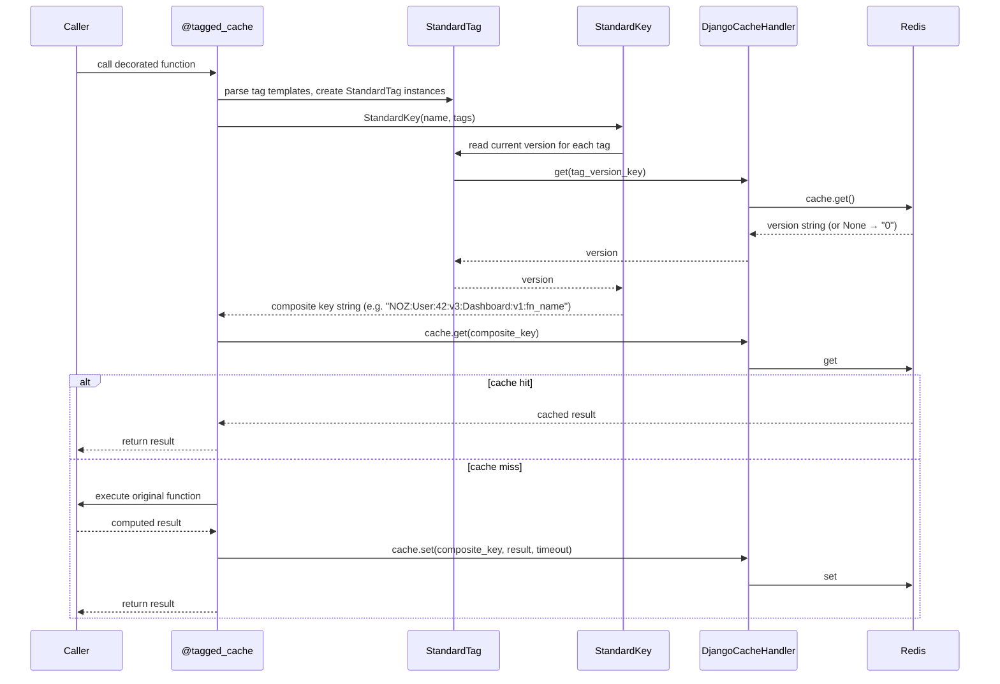
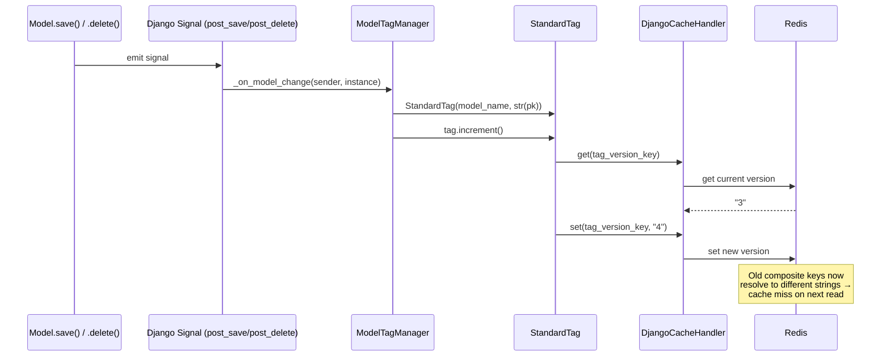
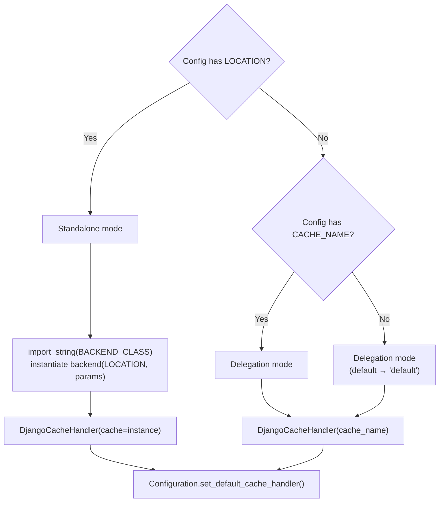

# Data Flow

## Cache Read (via `@tagged_cache`)

## Cache Invalidation (via signals)

## Key Composition

A `StandardKey` produces its cache key string by concatenating:

1. Global prefix (e.g. `NOZ`)
2. For each tag: `{tag_name}:{instance}:v{current_version}`
3. Base key name (function qualified name + vary_on params)

When any tag's version increments, the composed string changes, and the old cached value is never found again (it expires naturally via TTL).

## DjangoCacheHandler Adapter

`DjangoCacheHandler` implements the `fragmented_keys.CacheHandler` protocol:

| Protocol method | Django cache call | Notes |
|----------------|-------------------|-------|
| `get(key)` | `cache.get(key)` | Coerces result to `str` (handles bytes, dict, int) |
| `set(key, value, ttl)` | `cache.set(key, value, timeout=ttl)` | |
| `get_multi(keys)` | `cache.get_many(keys)` | Returns `dict[str, str]`, omits misses |

### Two construction modes

- **Delegation**: `DjangoCacheHandler("default")` → `caches["default"]` → shares the existing connection pool and config
- **Standalone**: `DjangoCacheHandler(cache=underlying)` → wraps a backend instance created by `FragmentedKeysCacheBackend.__init__` — no Django alias required

Both paths converge: `self._handler` is set, and all tag-aware methods use it identically.

## Telemetry Instrumentation Points

The library emits no metrics/logs by default. Subclass the backend to add observability:

| Hook | What it captures | Redis I/O |
|------|-----------------|-----------|
| `_build_tagged_key(key, tags, group_id)` | Tag version **reads** during key composition | 1 GET per tag |
| `invalidate_tags(tags)` | Tag version **writes** during invalidation | 1 SET per tag |
| `get_with_tags` / `set_with_tags` | Cache hit/miss, overall latency | 1 GET or SET for the data |

See `docs/usage/telemetry.rst` for StatsD, Prometheus, and OpenTelemetry examples.
